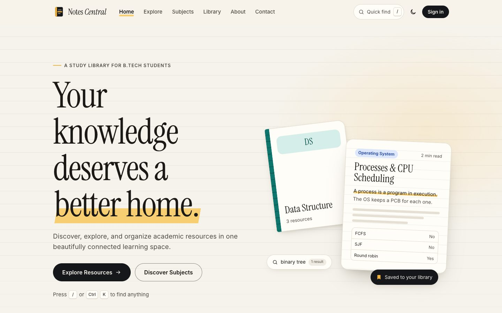
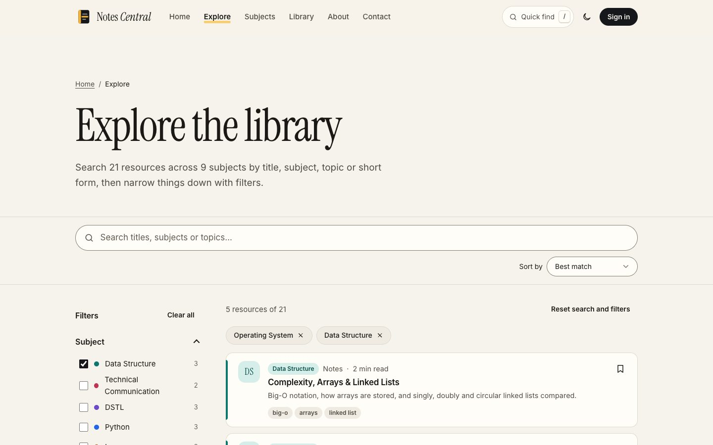
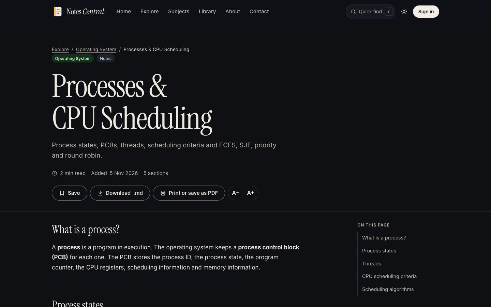
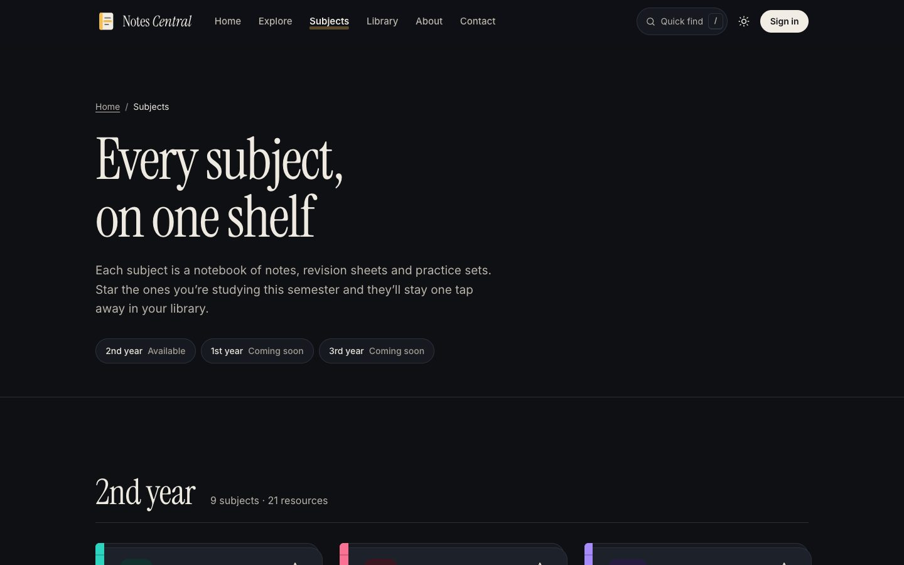
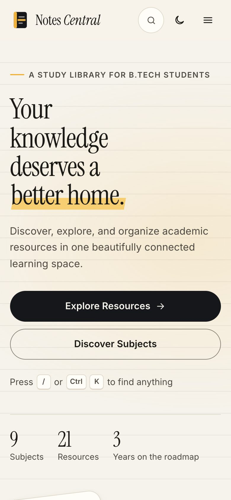
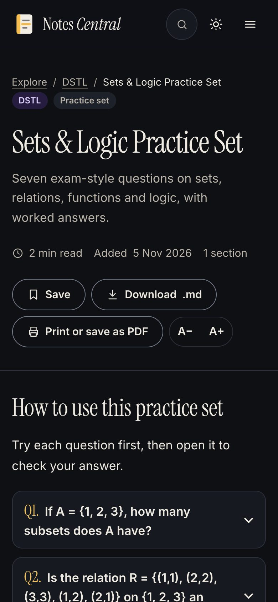

# Notes Central

**Your knowledge deserves a better home.**

Notes Central is an independently developed educational platform that makes academic resources easier to discover, access and navigate. It brings B.Tech subject notes together in one connected learning space, with a smart explorer, a reader built for revision, and a personal library that follows you between devices.



## Product vision

Study material usually ends up scattered across group chats, drives and phone photos. Notes Central treats it like a library instead:

- **Every subject gets a home.** Subjects are notebooks, grouped by year.
- **Every resource is one search away.** Search by title, subject, topic or short form ("OS", "COA", "UHV").
- **What you care about waits for you.** Bookmarks, reading history and favourite subjects live in your library.

## Unique features

| Feature | What it does |
| --- | --- |
| **Smart resource explorer** | Full-text search across titles, subjects, topics, types and categories; faceted filters with live counts; five sort orders; removable filter chips; shareable URLs (`notess.html?subject=python&type=Practice%20set`); loading, empty and error states with retry. |
| **Reader** | Renders Markdown notes safely, with a table of contents, reading-progress bar, adjustable text size (remembered), practice questions you reveal one at a time, related resources, Markdown download and print or save as PDF. |
| **Personal library** | Bookmarks, recently viewed resources and favourite subjects. Saved on the device straight away; synced to the account when signed in (most recent copy wins). Anything saved as a guest merges into the account on sign-in. |
| **Quick find** | A command palette on every page (`/` or `Ctrl`/`⌘` + `K`) for jumping to any subject, resource or action, entirely from the keyboard. |
| **Light and dark themes** | Two complete themes with contrast checked for each. Follows the OS until you choose, remembers your choice, and transitions smoothly. |
| **Accounts** | Sign up and sign in through the Node API (bcrypt + JWT); the library syncs through authenticated `/library` endpoints. |

## Screenshots

| Explorer | Reader (dark) |
| --- | --- |
|  |  |

| Subjects (dark) | Mobile | Mobile reader |
| --- | --- | --- |
|  |  |  |

## Technology stack

| Layer | Technology |
| --- | --- |
| Frontend | Semantic HTML5, one CSS design system (custom properties, Grid, Flexbox, `clamp()`), vanilla JavaScript ES modules. No framework, no runtime dependencies. |
| Content | `data/resources.json` catalogue + Markdown notes in `notes/` |
| API | Node.js, Express, MySQL, bcrypt, JSON Web Tokens |
| Alternative backend | Python, Flask, Flask-MySQLdb (`app.py`) |
| Contact form | Formspree |
| Fonts | Instrument Serif and Inter (Google Fonts) |

## Project architecture

```
├── index.html, notess.html, subjects.html, viewer.html,
│   dashboard.html, about.html, contact.html, login.html   ← pages (generated, see "Editing pages")
├── favicon.svg
├── css/
│   ├── style.css          design system: tokens, themes, components, page sections
│   ├── index.css          home page
│   └── loginstyle.css     sign in / sign up
├── js/
│   ├── script.js          entry module on every page: theme, header, menus,
│   │                      quick find, reveals; loads the page module below
│   ├── pages/             home · explorer · viewer · subjects · dashboard
│   ├── catalog.js         loads data/resources.json; search and scoring
│   ├── library.js         bookmarks, history, favourites (local-first + sync)
│   ├── auth.js            JWT session helpers
│   ├── ui.js              cards, notebooks, empty states, toggles
│   ├── markdown.js        safe Markdown renderer
│   ├── palette.js         quick-find command palette
│   ├── forms.js           accessible validation helpers
│   ├── util.js            storage, escaping, icons, formatting
│   ├── login.js           sign-in tabs
│   ├── notesscript.js     sign-in / sign-up requests
│   └── newscript.js       contact form
├── data/resources.json    subjects and resources (generated)
├── notes/*.md             the study notes
├── tools/
│   ├── build-catalog.py   builds data/resources.json from the notes
│   ├── build-pages.py     assembles the pages from tools/templates/
│   └── templates/         page templates + shared head, header, footer
├── docs/screenshots/      README images
├── server.js              Node/Express API
├── app.py                 Flask backend (optional, see below)
├── package.json, package-lock.json, requirements.txt
└── .env.example, .gitignore
```

### API

| Method | Path | Auth | Purpose |
| --- | --- | --- | --- |
| POST | `/signup` | — | Create an account `{ username, email, password }` |
| POST | `/login` | — | Returns `{ token, user }` |
| GET | `/me` | Bearer | Current user |
| GET | `/library` | Bearer | The user's synced library |
| PUT | `/library` | Bearer | Save the library `{ bookmarks, recent, favourites, updatedAt }` (validated) |

## Installation

### 1. Run the website

The frontend is static; any file server works (ES modules need `http://`, not `file://`):

```bash
python3 -m http.server 8080
# or: npm run serve
```

Open <http://localhost:8080>. Browsing, reading, search, bookmarks, history and themes all work without the backend; the library is saved in the browser.

### 2. Run the API (accounts and cross-device sync)

Requirements: Node.js 20.12+ and MySQL with a `UserAuth` database:

```sql
CREATE TABLE Users (
  id INT AUTO_INCREMENT PRIMARY KEY,
  username VARCHAR(100) NOT NULL,
  email VARCHAR(255) NOT NULL UNIQUE,
  password VARCHAR(255) NOT NULL
);
```

The `UserLibrary` table for synced libraries is created automatically on startup (`CREATE TABLE IF NOT EXISTS`); existing tables are never modified.

```bash
cp .env.example .env      # fill in your own credentials and secrets
npm install
npm start                 # http://localhost:5000
```

> **macOS:** AirPlay Receiver uses port 5000. Turn it off (System Settings → General → AirDrop & Handoff), or set `PORT=5001` in `.env` and update `notes-api-base` in `tools/templates/_head.html`, then rebuild the pages.

### 3. Flask backend (optional)

```bash
pip install -r requirements.txt
python app.py
```

> `app.py` is an alternative backend kept from the original project. It renders `index.html`, `login.html` and `register.html` from a `templates/` folder that isn't included, so it does not serve pages as-is; the site uses `server.js`.

## Environment configuration

All secrets come from environment variables or a local, git-ignored `.env` file. See `.env.example`.

| Variable | Used by | Purpose |
| --- | --- | --- |
| `PORT` | server.js | API port (default 5000) |
| `DB_HOST`, `DB_USER`, `DB_PASSWORD`, `DB_NAME` | server.js | MySQL connection |
| `JWT_SECRET` | server.js | Token signing secret (long random string) |
| `CORS_ORIGIN` | server.js | Allowed site origin in production |
| `FLASK_SECRET_KEY`, `FLASK_MYSQL_*`, `FLASK_DEBUG` | app.py | Flask configuration |

The frontend reads the API address from `<meta name="notes-api-base">`.

## Adding or editing notes

1. Write a Markdown file in `notes/` (supported: `##`/`###` headings, lists, tables, code blocks, `>` callouts, and practice questions written as `?? Question` followed by the answer).
2. Add an entry to `RESOURCES` (and, for a new subject, `SUBJECTS`) in `tools/build-catalog.py`.
3. Rebuild:
   ```bash
   python3 tools/build-catalog.py   # updates data/resources.json, with reading times computed from word counts
   python3 tools/build-pages.py     # refreshes counts and subject links in the pages
   ```

## Editing pages

The HTML files in the project root are generated. Edit `tools/templates/` (pages and the shared `_head`, `_header`, `_footer` partials), then run `python3 tools/build-pages.py`. The output is plain static HTML; no build step is needed to *run* the site.

## Responsive design

- Mobile-first layouts with fluid type (`clamp()`), auto-fitting grids (`minmax()`), a full-height mobile menu, collapsible filters, and touch targets of 44px or more.
- Tested at 320, 360, 375, 390, 430, 600, 768, 1024, 1280, 1440 and 1920px: no horizontal scrolling, clipped text or off-screen content.

## Accessibility (WCAG 2.0 AA)

- Semantic landmarks, logical headings, skip link, and descriptive page titles.
- Everything works from the keyboard: the mobile menu (with the page behind made inert and Escape to close), account menu, quick find (combobox + listbox pattern on a native `<dialog>`), login tabs (arrow keys, Home and End), and filter accordions.
- Visible focus rings; state is never shown by colour alone (pressed toggles change shape, the current page has a marker and bold text).
- Labelled forms with inline errors linked by `aria-describedby`; status messages are announced.
- Contrast checked with axe in both themes; `prefers-reduced-motion` turns off animation; usable at 200% zoom.

## Quality checks

Run locally against the finished site:

- **axe-core** (WCAG 2.0 A/AA + best practices): 0 violations on all 8 pages, light and dark, at 375px and 1440px.
- **Lighthouse:** Accessibility 100, Best Practices 100 and SEO 100 on every page, mobile and desktop; Performance 94–100.
- **Functional tests** (Puppeteer): 106 checks covering navigation, themes, quick find, explorer, reader, library, sign-in and sync, and the contact form.
- **API tests:** 17 endpoint checks against `server.js` with an in-memory database.

## Future improvements

- 1st and 3rd year subjects (on the roadmap).
- PDF resources alongside Markdown notes.
- Full-text search inside note bodies.
- Password reset and email verification.
- An offline mode (service worker) for reading without a connection.
